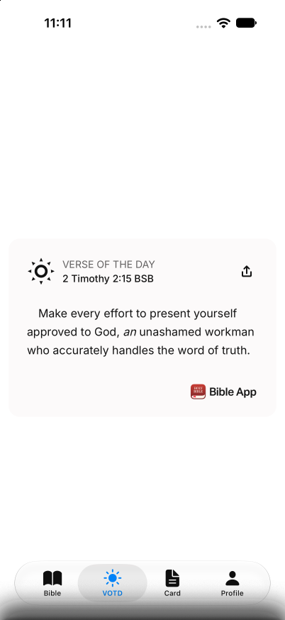

# YPE-6426 live API and iOS verification

Verified on 2026-11-05 with published shared core 2.17.0 and the example app's configured app key. No user sign-in was required. Credentials, image IDs, and cursor values are omitted from this record.

## Live API

- `GET /v1/search-images` with `query=hope`, `bible_id=111`, and `page_size=99` returned six HTTP 200 pages. Their image counts were 99, 99, 99, 99, 99, and 1. Each continuation token was sent unchanged with the same query, Bible ID, and page size. The last token was `null`. No token was empty or repeated.
- A query with no matching images returned HTTP 200 with an empty image list and a `null` token.
- `GET /v1/verse-of-the-days` returned all 366 unique days, from 1 through 366, without a continuation token. The shared client returned `next_page_token: null`.
- `GET /v1/verse-of-the-days/309` returned `day: 309`, `passage_id: 2TI.2.15`, and `image_id: null` without language ranges. With English language ranges, the shared client returned an image ID. Passing it unchanged to `ImagesClient.getImage` returned the same ID and a CDN URL.

These observations agree with the published [calendar endpoint and parameters](https://github.com/youversion/youversion-platform-developer-hub/blob/a758a16687af294244e22bae5e053ffec9697a59/devdocs/apis/openapi.yaml#L1363) and [calendar response schema](https://github.com/youversion/youversion-platform-developer-hub/blob/a758a16687af294244e22bae5e053ffec9697a59/devdocs/apis/schemas/verse_of_the_days.yaml). The calendar endpoint has no pagination input. Image search tokens remain opaque at the SDK boundary. A consumer that loops over pages should reject repeated tokens and set a request limit.

## Native card

The example app ran from this PR's source on an iPhone 18 Pro simulator with iOS 27.0. Its VOTD tab displayed today's live passage, `2 Timothy 2:15 BSB`, verse text, attribution, and an enabled Share control.

The simulator run verified the successful live route. Malformed responses were tested separately through the real installed shared client in `packages/ui/src/native/__tests__/verse-of-the-day.test.tsx`. A numeric `image_id` produces the visible retry control and disables sharing. Pressing retry after a valid response restores the scripture bridge and sharing. The test stubs the network and the DOM implementation, following the native test seam.

## Limits

The live requests are observations of the deployed API on the verification date. They do not prove that future server responses cannot contain malformed fields or repeated tokens. The malformed-response test is deterministic coverage of that failure path. Android was not exercised in this pass.
